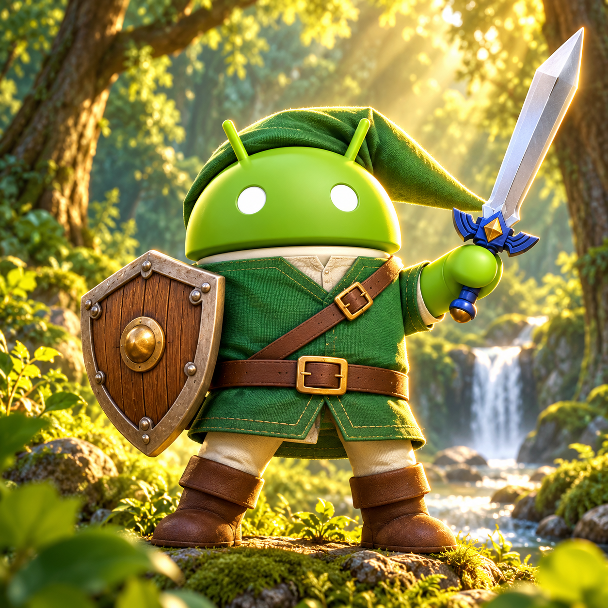
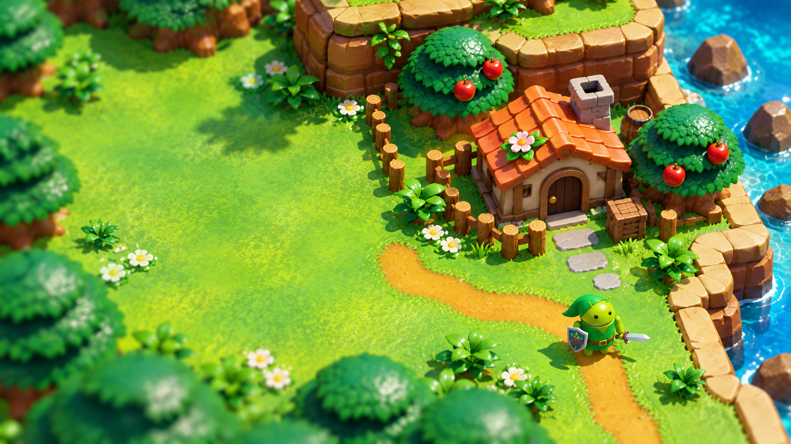
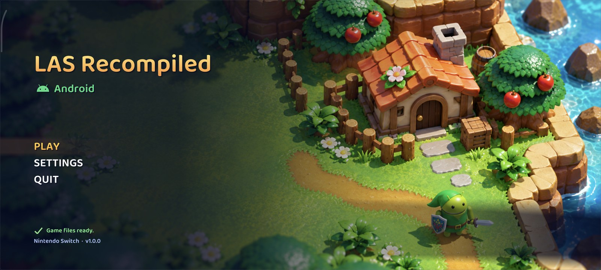

# LAS Recomp for Android

**English** | [Português](README.pt-BR.md)

An Android port of **[LAS Recomp](https://github.com/peiikai/LASRecomp)** by peiikai: a static recompilation of
*The Legend of Zelda: Link's Awakening* (Nintendo Switch, 2019). As in the original project, this is **not
emulation**: the Switch code becomes native ARM64 code, and the game's graphics (NVN) are translated to Vulkan.
For the PC versions (Windows, macOS, Linux), features and the randomizer, see the
[original repository](https://github.com/peiikai/LASRecomp).

> [!IMPORTANT]
> Like the original, this port was made almost entirely with AI: the porting work was written by Claude (Opus 5.5,
> by Anthropic, through Claude Code), with subsequent development assisted by **GPT Astra** and **GPT Sol 6.1**
> (OpenAI, through Codex), directed, tested and reviewed by a human. You run the code at your own discretion.

> [!WARNING]
> **Experimental.** Get the APK from the [Releases](https://github.com/mamcjr/LASRecompAndroid/releases) page:
> everything else (your game files, the game code, the driver) is set up from the app, on the phone. The full plan,
> the state of each phase and the measurements are in [docs/ANDROID-PORT.md](docs/ANDROID-PORT.md) (in Portuguese).

> [!NOTE]
> **No game files are included**, and the app contains nothing from the game. You need your own legally obtained
> copy of the extracted game files of *Link's Awakening* **v1.0.0**. Instructions on how to obtain them will not be
> provided.

## New in 0.4.0

Frame generation (30 → 60 and 60 → 120), game mods, menus in Portuguese and a new upscaler.

- **Frame generation** (Video > Frame generation, off by default): in-between frames made from the picture, the scene's depth and the camera's movement, adapted from [LASRecomp-Android-Plus](https://github.com/Nycolazs/LASRecomp-Android-Plus). The game's 30 fps become 60 and, with the 120 Hz option, its 60 become 120 (the game keeps its own 60 Hz clock). The HUD stays put and Link doesn't shake; when the GPU can't keep up it pauses by itself and tries again later. On the POCO F7 Ultra with Turnip, at 60 → 120 in the village, it cost ~0.4 ms of GPU per real frame and stayed on the whole time. With Qualcomm's stock driver, use 30 fps.
- **120 Hz option** (under frame generation, off by default): on, it asks for the display's fastest mode and the game's 60 fps become 120; off, it asks for 60 Hz. Where the phone's own settings fix the display at 120 Hz, the in-between frames follow the display.
- **Objects' own movement** (experimental): characters that move on their own move in the in-between frames too.
- **Mods** (Settings > Mods): folders with a `romfs` folder inside, as for Eden and Ryujinx, each turned on or off; a mod's folder can be imported with the Android folder picker. Tested with the [Triforce Heroes](https://triforce-heroes.com.br) team's Brazilian Portuguese translation, which doesn't come with the app.
- **Menus in Portuguese** on a phone set to Portuguese: settings, the start screen, the save editor and messages.
- **Snapdragon Game Super Resolution 1 upscaler** (Qualcomm): a single pass, lighter than FSR 1.
- **Performance overlay:** the frame rate with frame generation (FPS+FG), a compact one-line style (FPS, FPS+FG, RAM, battery temperature), and it can be dragged anywhere on the screen.
- **Menu with a controller:** the first press is no longer lost, left / right change values, A or L / R go into the page and B closes.
- **Vulkan 1.1 / 1.2 drivers** with the extensions matching 1.3 are accepted now (such as stock Mali drivers); when one is missing, the message names it.
- **32-bit shader math** (Video): for drivers that draw lighting, grass or text wrong.
- **Setup takes less space:** `romfs.bin` is built straight from the picked folder. The free space it asks for went from ~14 GiB to ~8 GiB, and existing installs get ~5.7 GiB back by themselves.
- **Setup's compile step:** the game's functions outside the play profiles (LASRecomp-Android-Plus's list) are compiled without optimization.
- **Dynamic resolution at a fixed 30 fps** aims at 30's budget, not 60's.
- Menu and on-screen controls themed after Link's Awakening. No randomizer on Android.

Validation: on the POCO F7 Ultra, frame generation 30 → 60, 60 → 120 and 30 → 120 with Turnip and with the stock driver; mods (the translation applied, turned off, imported with the picker); translated menus; the menu with simulated controller presses; the overlay dragged; SGSR 1; setting the game up from scratch from the picked folder (about 7 min 40 s: `romfs.bin` in about 45 s, then the compile), after which the game ran with the translation mod into the village. Not tested on a phone yet: Vulkan 1.1 drivers (Mali) and the Adreno 750.

## New in 0.3.9

Focused on compatibility with more phones and drivers.

- **Stock drivers without `shaderInt64`** (e.g. Galaxy S23, Adreno 740): shader address and carry math now uses 32-bit words when the driver has no 64-bit integers. On the S23 with Qualcomm's driver, lighting, grass tufts and inventory text are back. Drivers that have the feature, such as Turnip, keep the native path. [Diagnosis](docs/ANDROID-S23-STOCK-RENDERING.md).
- **Sturdier Vulkan startup:** the swapchain only requests usages and composition the surface supports; the pipeline cache is validated before use; optional features are queried before they are enabled. When something fails, the error dialog shows the reason on screen, no adb needed.
- **Importing:** checks free space before copying, detects incomplete copies and refuses the app's own imported folder.
- **Fixed 30 fps now holds 30 on Turnip.** The game picks its mode from how many vsyncs each frame really takes, and with the render thread Turnip's frames fit in one, so it went back to 60. The option now turns on the game's own 30 fps mode and the presentation waits for both vsyncs, as the Switch does. On the POCO F7 Ultra: a steady 30.0 fps with Turnip and with the stock driver, back to normal when switched to Auto. Auto mode is unchanged.
- **New installs** start at a fixed 30 fps and 50% internal resolution. Existing saved settings still apply.
- **Bug report form** asks at which stage the failure happens; a screenshot of the error dialog already helps.
- **Measurement tools** (village benchmark route, settings matrix, GPU timing and texture traces), all off by default.

Validation: on the Galaxy S23 with the stock driver, lighting, grass and text were checked visually in two loads, with the previous APK as a control. On PC, tests for the 32-bit shader translation, shader cache, constant tables and Vulkan startup. Mali GPUs still need testing on real hardware. [Compatibility](docs/ANDROID-COMPATIBILITY.md).

## New in 0.3.8

Updated 0.3.8 APK: the start screen shows only **PLAY**, without the Vanilla/seed selector. The new background follows the game's toy-like miniature village style, with a small Android adventurer.

- **Touch settings:** large sidebar categories, inline descriptions, larger controls and dropdown choices, swipe scrolling and a persistent Back button. Video, Audio and Controls are directly accessible; Saves & files is available before launch, and More options contains the remaining pages.
- **Rendering work:** pipeline configuration reuse, reusable texture-conversion buffers, exact comparisons for stable dynamic textures, load-only arena-copy reuse, and queued compute-shader translation. Shader compiler worker count is configurable.
- **Stable ADPF default:** retains the established wall-time performance signal, with synchronized session management. In the user's 50% resolution comparison on Turnip, the captured intervals improved from roughly 52–58 FPS to 58.9–59.9 FPS after restoring this signal. Occasional long frames remain; this is not a controlled benchmark or a guarantee for other devices.
- **Faster updates:** the bundled game builder is unpacked only when its content fingerprint changes.
- **New artwork:** an Android adventurer icon and an original island-themed launcher background generated with OpenAI image generation. These are fan illustrations, not extracted game assets.

Validation: release build on PC, 22 upload-cache checks , 12 simulated touch-gesture checks and 28 save-transfer checks; the user tested frametime on the connected Turnip device. Qualcomm/Mali copy-path behavior and all menu flows still require broader device testing. Details: [optimizations](docs/ANDROID-OPTIMIZATIONS.md), [touch settings](docs/ANDROID-TOUCH-SETTINGS.md).

<!-- stationary-matrix-s23:start -->
## Measured performance — Galaxy S23

2026-10-21 · SM-S911B, Adreno 740, Android 16 · **Auto FPS**. Stationary Mabe Village scene, same position/save, one Turnip game run with all 40 combinations. Each profile had 10 s settling and 30 s collection. Values are average presentation FPS measured by Android. Auto lets the game choose 30/60 FPS; it does not unlock 120 FPS.

**Test condition:** local diagnostic APK, Turnip v26.0.0 R8, unchanged ADPF and `LARECOMP_VK_NO_PLACED=1` with Turnip. Without that temporary memory workaround, Android killed Turnip for low memory on this S23, including after closing other apps. These results do not represent a fix already shipped in release 0.3.8.

Turnip FPS — 40 samples

| Resolution | Aspect | Filter | AA | Turnip R8 |
| --- | --- | --- | --- | ---: |
| 50% | 16:9 | Bilinear | Off | 31.28 |
| 50% | 16:9 | Bilinear | SMAA | 30.37 |
| 50% | 16:9 | FSR1 | Off | 31.14 |
| 50% | 16:9 | FSR1 | SMAA | 32.28 |
| 50% | Unlocked | Bilinear | Off | 29.92 |
| 50% | Unlocked | Bilinear | SMAA | 29.81 |
| 50% | Unlocked | FSR1 | Off | 29.30 |
| 50% | Unlocked | FSR1 | SMAA | 27.24 |
| 75% | 16:9 | Bilinear | Off | 29.97 |
| 75% | 16:9 | Bilinear | SMAA | 30.00 |
| 75% | 16:9 | FSR1 | Off | 29.91 |
| 75% | 16:9 | FSR1 | SMAA | 29.68 |
| 75% | Unlocked | Bilinear | Off | 26.32 |
| 75% | Unlocked | Bilinear | SMAA | 24.26 |
| 75% | Unlocked | FSR1 | Off | 23.27 |
| 75% | Unlocked | FSR1 | SMAA | 22.61 |
| 1x | 16:9 | Bilinear | Off | 25.21 |
| 1x | 16:9 | Bilinear | SMAA | 23.75 |
| 1x | 16:9 | FSR1 | Off | 25.31 |
| 1x | 16:9 | FSR1 | SMAA | 23.33 |
| 1x | Unlocked | Bilinear | Off | 20.59 |
| 1x | Unlocked | Bilinear | SMAA | 20.05 |
| 1x | Unlocked | FSR1 | Off | 20.16 |
| 1x | Unlocked | FSR1 | SMAA | 21.50 |
| Dynamic | 16:9 | Bilinear | Off | 29.93 |
| Dynamic | 16:9 | Bilinear | SMAA | 29.97 |
| Dynamic | 16:9 | FSR1 | Off | 30.00 |
| Dynamic | 16:9 | FSR1 | SMAA | 29.97 |
| Dynamic | Unlocked | Bilinear | Off | 29.96 |
| Dynamic | Unlocked | Bilinear | SMAA | 29.96 |
| Dynamic | Unlocked | FSR1 | Off | 29.55 |
| Dynamic | Unlocked | FSR1 | SMAA | 28.30 |
| Match Display | 16:9 | Bilinear | Off | 24.96 |
| Match Display | 16:9 | Bilinear | SMAA | 23.74 |
| Match Display | 16:9 | FSR1 | Off | 26.95 |
| Match Display | 16:9 | FSR1 | SMAA | 24.77 |
| Match Display | Unlocked | Bilinear | Off | 21.05 |
| Match Display | Unlocked | Bilinear | SMAA | 20.68 |
| Match Display | Unlocked | FSR1 | Off | 20.46 |
| Match Display | Unlocked | FSR1 | SMAA | 20.25 |

Without FSR1 = bilinear; enabled AA = SMAA. Dynamic changes resolution during the sample. This is a configuration sweep with one sample per combination; it does not establish moving-scene stability or a causal improvement from an individual setting. Order, temperature and caches can affect results. [Protocol and telemetry](docs/ANDROID-STATIONARY-MATRIX.md) · [FPS data](docs/benchmarks/galaxy-s23-20261021.json).

Stock driver: comparison stopped because of incomplete rendering (reported lighting, grass and text issues). Its partial FPS results are excluded from this table. The cause (no `shaderInt64`) is fixed in 0.3.9; the stock-driver measurement has not been redone yet. POCO F7 Ultra testing is deferred while compatibility is investigated.
<!-- stationary-matrix-s23:end -->

## Importing and exporting saves

On the start screen, open **Settings → Saves & files → Saves - Eden / Yuzu / Ryujinx**:

- **Import save folder**: select the *Link's Awakening* save folder containing `savedata0.bin`
  (or another `savedataN.bin`) and the game's other `.bin` files.
- **Import save ZIP**: select a ZIP of that folder. An enclosing folder is accepted; archives with
  multiple save profiles are rejected to avoid mixing progress.
- **Export saves**: choose where to save the ZIP. With the game closed in the emulator, extract its contents
  into the *Link's Awakening* save folder opened by Eden, Yuzu or Ryujinx.
- **Export previous saves**: export the backup from before the last import. Import that ZIP to restore it.

Import replaces all slots in the selected save set and keeps a copy of the previous saves. Transfers are available
before starting the game. If Android does not allow selecting another app's folder, export the saves from the
emulator to an accessible folder such as Documents, then select that copy or ZIP here.
The original `.bin` files are transferred without conversion; randomizer sidecars are not included in the ZIP.

## Screenshots

|  |  |
|:-:|:-:|
|  |  |

On a POCO F7 Ultra with Turnip: the touch controls on screen, the performance overlay on (top left).

At 75% internal resolution (1080p) and full screen: 55-60 fps, mostly 60.

At 75% (1080p) in 16:9, the Switch's shape (bars at the sides): a steady 60 fps.

At native resolution (3200×1440, 100%) and full screen: a steady 30 fps, in the game's own 30 fps mode (full speed).

## Status

Tested on a **POCO F7 Ultra** (Snapdragon 8 Elite / Adreno 830, Android 16) with the **Turnip Gen8 V37** driver:

- the game boots, the movies play with sound, and the menus, saves and gameplay work;
- **a steady 60 fps**, the overworld included, at the default 50% internal resolution (720p): 98% of the time at 60
  in our overworld measurements, with no frame over 18 ms. At 75% (1080p) it held 60 in 16:9 and ran at 55-60 fps full screen in our
  tests, and at native resolution (3200×1440) full screen at a steady 30. The game
  still has its own 30 fps mode, as on the Switch, for when a frame can't fit;
- **touch controls**: a floating stick, A / B / X / Y, L / R / ZL / ZR, Minus / Plus and a menu button, shown while
  no controller is connected (they hide as soon as one is). Their layout can be edited (drag them where you like,
  size, opacity) in the in-game menu's Controls tab; the Android back button opens the menu;
- Bluetooth controllers (tested with a GameSir X4 Aileron), remappable in the Controls tab;
- a frame rate setting (Video tab): Auto (the game's own 30 / 60 choice), 30 fps or 60 fps;
- a performance overlay (fps, frame time, CPU clusters, ADPF session status and thread times/cores, GPU, memory, temperature, battery), and no black screen after the app comes
  back from the background. The in-game menu leaves out the desktop's options (fullscreen, 4K / 8K, randomizer).

### What made it fast

The game's shaders are translated from the Switch GPU's code to GLSL at run time. On Adreno the translated shaders
were the bottleneck, so on Android the translator now:

- resolves the control-flow stacks at translation time instead of keeping them as arrays in every shader;
- turns branches, loops and jump tables (read from the shader's own constants) into structured `if` / `for` /
  `switch` code instead of a `switch (pc)` state machine, which the mobile compiler handled poorly (the overworld's
  lighting shader went from 24 to 16-19 registers and from 2884 to 1717 instructions);
- converts half-precision values with the GPU's own instructions in fragment and compute shaders.

On the CPU side:

- **a render thread**: the game's command lists are translated to Vulkan on a thread of their own while the game
  works on its next frame, and handed to the GPU in chunks so it starts before the whole frame is translated. The
  game's thread went from ~11.4 to ~7.4 ms of work a frame;
- **the Switch's core 0, emulated**: the game runs some of its job threads on the same core as its main thread, where
  they take turns; truly parallel, a faster main thread exposed a race in its job system (a crash). Those threads now
  take turns here too, while the game's other cores stay parallel;
- **frame pacing** that tells the game's own 30 fps frames from a 60 fps frame that ran late, Android's performance
  hints (ADPF) with a single unified session for both threads aimed at 60 fps, and fixes to three thread-synchronization races in the emulated kernel;
- the runtime is built optimized, the game's GPU fences no longer wait for the compositor, and per-draw work is
  cached.

## Turnip or the phone's own driver

The game runs, **lighting included**, both with Mesa's **Turnip** driver and with the phone's own **Qualcomm** driver.
Turnip is still the one to use for **60 fps**:

| Driver | Lighting | Overworld (720p) |
|---|---|---|
| Turnip | yes | 60 fps (98% of the time) |
| Qualcomm's own | yes | 30 fps |

On the phone's own Qualcomm driver, no Turnip (the overlay's GPU line says "Qualcomm"): the lighting is there.

The game's shaders read and write the game's memory directly, at the same addresses the CPU uses: for example, each
frame's light list is built by a compute shader and then read by the pixel shaders, and some shaders reach data
through pointers. On PC, the game's memory is imported into the GPU with `VK_EXT_external_memory_host`, which
neither driver has.

- **Turnip** has `VK_EXT_map_memory_placed`: GPU memory is allocated at the exact address of the game's heap, so the
  CPU and the GPU share the same memory, with no copies.
- **Any other driver** (Qualcomm's, and in principle Mali, Xclipse and others) goes through a **GPU arena**: the
  memory regions the shaders write live on the GPU, so the draws that read them see the results in the same frame;
  the CPU's changes are found and copied in by the GPU, and the GPU's results go back to the game's memory once
  done. The regions shaders reach through pointers are found at run time: the shaders record their misses and those
  regions are added. That costs more than Turnip's shared memory, hence 30 fps for now.

## Current limitations

- Tested on Snapdragon (Adreno): with Turnip at 60 fps, with the phone's own driver at 30 fps (lighting included in
  both). The app loads Turnip with [libadrenotools](https://github.com/bylaws/libadrenotools); the driver is not
  included, you provide your own. **Mali**: the game ran on a Mali-G615 at 20-30 fps; since 0.3.3 its textures are
  decoded on the CPU (Mali has no BC textures, the Switch's format), which fixed the colored blocks seen there - still
  to be confirmed on more Mali phones. Xclipse and others should work through the same path: reports are welcome.
- You need your own v1.0.0 dump, and about **12 GB free** for the setup (the app keeps its own copy of the game
  files plus a data image built from them); the dump itself can be deleted afterwards.
- The first setup builds the game code on the phone: about 20 minutes on a Snapdragon 8 Elite.
- Changing the resolution while the game is running can close the app. Change it on the title screen.
- No randomizer on the phone yet.

## Installing

You need an arm64 phone with Android 11 or newer (tested on a Snapdragon), your own extracted v1.0.0 game files (the
folders `exefs` and `romfs`) copied somewhere on the phone, and, for 60 fps on an Adreno GPU, a Turnip driver package
(the adrenotools `.zip`, as used by other emulators).

1. Install the APK from the [Releases](https://github.com/mamcjr/LASRecompAndroid/releases) page.
2. Open the app, tap **Game files folder** and pick the folder that holds `exefs` and `romfs` (or the folder above
   it). Android asks you to allow access to it: the app copies the files to its own folder.
3. Wait for the setup: the copy, the game data image and the game code (about 20 minutes the first time; keep the
   screen on).
4. Optional, for 60 fps on Adreno: **Settings > Prelaunch > Vulkan driver > Choose driver**, pick the Turnip `.zip`,
   then **Restart now**. Without it the game runs on the phone's own driver, lighting included, at 30 fps.
   If a driver leaves the screen garbled or the app won't open, long-press the app icon and choose
   **System driver**: the app goes back to the phone's own driver. Tested on the Adreno 830 (Snapdragon 8 Elite):

   | Driver | Result |
   | --- | --- |
   | Turnip Gen8 V37 | works, 60 fps |
   | [whitebelyash](https://github.com/whitebelyash/freedreno_turnip-CI/releases) Stable Turnip V2, Mainline Turnip V32, A8XX Turnip V29 | work, 60 fps |
   | Turnip v26.3.0-R6 | garbled screen, then a crash in game |
   | [K11MCH1](https://github.com/K11MCH1/AdrenoToolsDrivers/releases) Turnip A8XX Draft (`turnip_a8xx.zip`) | the GPU stops responding (device lost) |
   | K11MCH1 Turnip v26.0.0 R8 | built for the A7xx: no GPU here, so the app uses the phone's own driver |
5. **Play**, with the touch controls or a controller. The on-screen menu button, the back button or Minus + Plus on a
   controller opens the in-game menu.

The app keeps everything in `Android/data/com.lasrecomp.android/files/`: saves, settings, the pipeline cache and the
game files. Uninstalling the app deletes that folder, saves included: copy the `save` folder out first.

## Building from source

On Windows with Git Bash, the Android SDK with **NDK 30.0.16248370** and **CMake 3.30.4**, a phone with USB
debugging, and Python 3.12. On Linux the same steps should work with bash, but they are untested there.

1. The app's dependencies (SDL3, shaderc, Vulkan-Headers, VMA, volk and the DejaVu font):
   `bash android/deps/build_deps.sh`.
2. Optional: FFmpeg, for the movies and the start screen's background. Its `configure` wants a Unix shell, so on
   Windows run it in WSL: `wsl -- bash android/deps/build_ffmpeg.sh`.
3. The game code's builder that the app carries (Python 3.14 for Android, capstone, lz4, zig):
   `bash android/deps/build_gen_deps.sh`; unicorn needs a Unix shell too: `wsl -- bash android/deps/build_unicorn.sh`.
4. The app: `cd android/lasrecomp && ./gradlew assembleRelease` (signed with your key from
   `~/.lasrecomp/keystore.properties` if it exists, else with the debug key), then
   `adb install -r app/build/outputs/apk/release/app-release.apk`, and set up as in [Installing](#installing).

For development, the game code can still be built on the PC and pushed: `bash android/build_gamelib.sh <dump>/exefs`
(with `python -m venv tools/venv` and `pip install lz4 capstone unicorn`), then
`bash android/push_game.sh <folder with exefs/ and romfs/>`.

## Credits

- **[LAS Recomp](https://github.com/peiikai/LASRecomp)** by peiikai: the recompiler, the runtime, the Vulkan renderer
  and the shader translator this port builds on. Its README credits everyone behind it, including LAS-Randomizer and
  the community mods its options re-implement.
- **[LASRecomp-Android-Plus](https://github.com/Nycolazs/LASRecomp-Android-Plus)** by Nycolazs (MIT): the Vulkan 1.1 /
  1.2 path with extensions for drivers below 1.3 (`runtime/nvn/vulkan/device.c`) follows its approach, and its list
  of hot game functions from play profiles (`tools/hot_functions.txt`) lets setup compile the rest faster; the frame
  generation by reprojection (`runtime/nvn/vulkan/framegen.c`) is adapted from its own.
- [SDL 3](https://libsdl.org) (zlib): window, input, audio and the Android activity.
- [libadrenotools](https://github.com/bylaws/libadrenotools) by bylaws (BSD 2-Clause): loads a custom Vulkan
  driver.
- [Mesa Turnip](https://docs.mesa3d.org/drivers/freedreno.html) (MIT): the Vulkan driver it is meant for (not
  included).
- [shaderc](https://github.com/google/shaderc) (Apache 2.0), [Vulkan-Headers](https://github.com/KhronosGroup/Vulkan-Headers)
  (Apache 2.0 / MIT), [volk](https://github.com/zeux/volk) (MIT) and
  [Vulkan Memory Allocator](https://github.com/GPUOpen-LibrariesAndSDKs/VulkanMemoryAllocator) (MIT).
- [FFmpeg](https://ffmpeg.org) (LGPL 2.1+, optional, linked dynamically): movie playback.
- The game code's builder, run on the phone: [Python](https://www.python.org) 3.14 (PSF license),
  [Zig](https://ziglang.org) 0.17 (MIT), [Capstone](https://github.com/capstone-engine/capstone) 5.0.9 (BSD 3-Clause),
  [Unicorn](https://github.com/unicorn-engine/unicorn) 2.1.4 (GPL 2.0; its unmodified source:
  [2.1.4](https://github.com/unicorn-engine/unicorn/archive/refs/tags/2.1.4.tar.gz), built by
  `android/deps/build_unicorn.sh`) and [LZ4](https://github.com/lz4/lz4) 1.10.0 (BSD 2-Clause).
- [Dear ImGui](https://github.com/ocornut/imgui) (MIT): the overlay menu and the start screen.
- [SMAA](https://github.com/iryoku/smaa) and [AMD FidelityFX Super Resolution 1](https://github.com/GPUOpen-Effects/FidelityFX-FSR)
  (MIT): the anti-aliasing and upscaler options, built into the renderer.
- [Snapdragon Game Super Resolution 1](https://github.com/SnapdragonStudios/snapdragon-gsr) by Qualcomm (BSD 3-Clause,
  [`third_party/sgsr/LICENSE`](third_party/sgsr/LICENSE)): the Snapdragon GSR 1 upscaler option
  (`runtime/nvn/vulkan/shaders.c`).
- Game mods (Settings > Mods, `runtime/mods.c`): folders with a `romfs` folder inside, as for Eden or Ryujinx, each
  turned on or off in the menu; none are included. For the game's text in Brazilian Portuguese, the fan translation
  by the [Triforce Heroes](https://triforce-heroes.com.br) team (translated by Ewerton and Jacilene, reviewed by David,
  Ricardo and Nelson): download it from their site, extract it, and import its folder with Settings > Mods > Import a
  mod folder (or copy it into `Android/data/com.lasrecomp.android/files/mods/`). It replaces the US English text:
  keep Language on Auto or English.
- The Android robot on the start screen is reproduced or modified from work created and shared by Google and used
  according to terms described in the [Creative Commons 3.0 Attribution License](https://creativecommons.org/licenses/by/3.0/).
- [DejaVu fonts](https://dejavu-fonts.github.io) (Bitstream Vera license): stand-in for the Switch's system font.

## Legal

This is a fan project. It is not affiliated with, endorsed by or sponsored by Nintendo. *The Legend of Zelda* and
*Link's Awakening* are trademarks of Nintendo. No game files, game code, assets or fonts are included, in this
repository or in any build. You must provide your own legally obtained copy of the game files to play.

## Contributing and support

Report Android bugs and suggestions in this fork's [Issues](https://github.com/mamcjr/LASRecompAndroid/issues).
Portuguese and English are welcome. See [CONTRIBUTING.md](CONTRIBUTING.md) for device details to include,
Android development, validation and pull request guidance.

## License

The code is open source under the [MIT License](LICENSE). The original LAS Recomp copyright notice for Peiikai
is preserved; an additional notice identifies contributions by mamcjr and LASRecompAndroid contributors.
Third-party components keep their own licenses (above, and in the
[original README](https://github.com/peiikai/LASRecomp#license)). The license
covers this project's code only: it grants nothing for Nintendo's game, which you must supply yourself.
